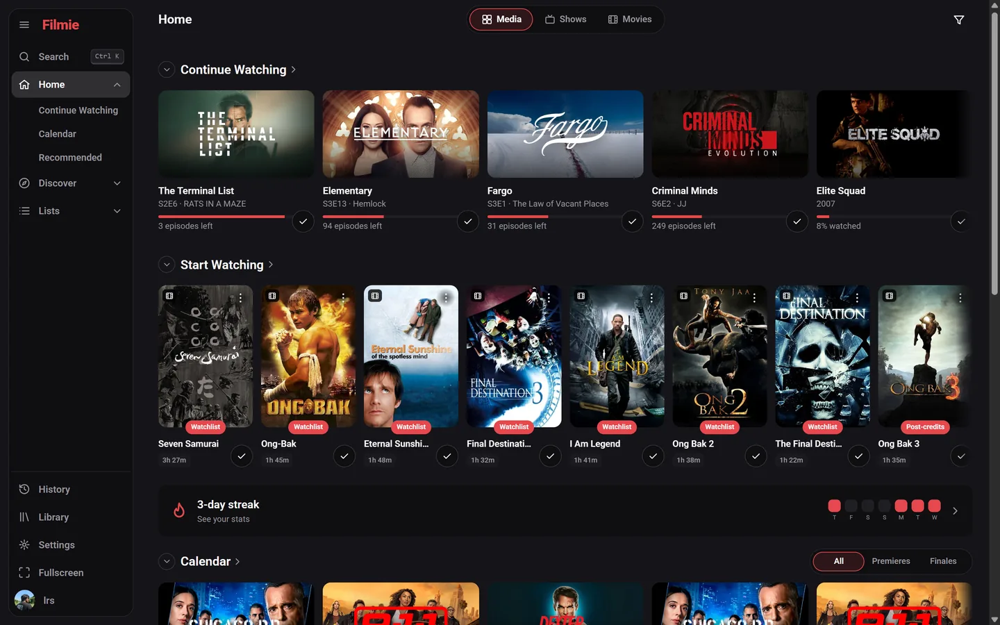
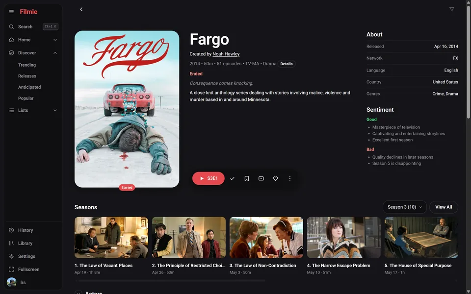
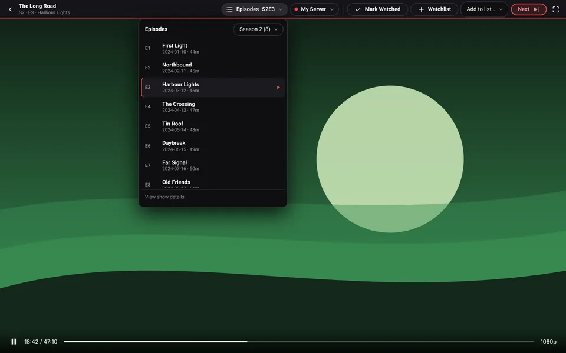
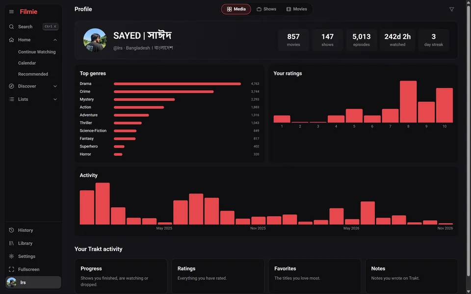
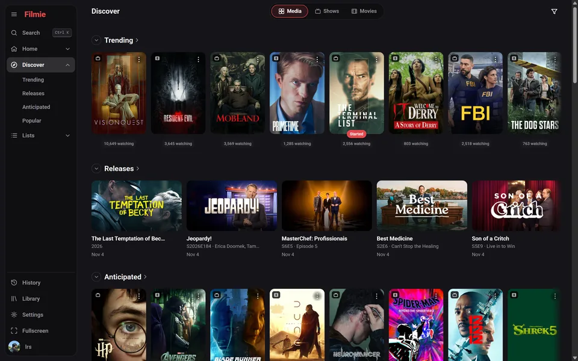
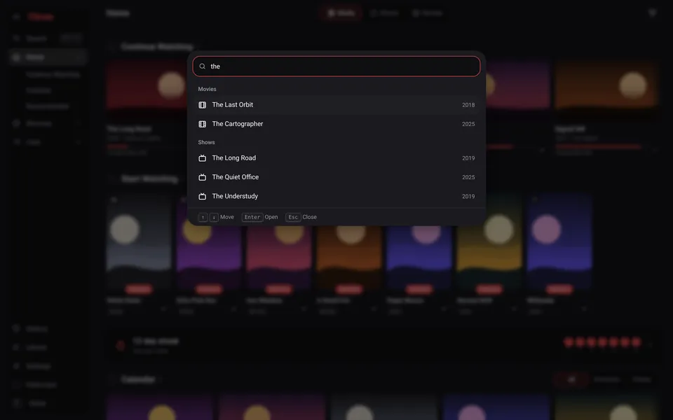
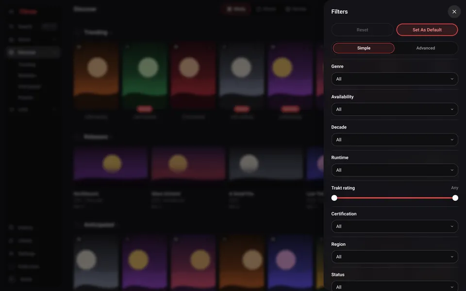
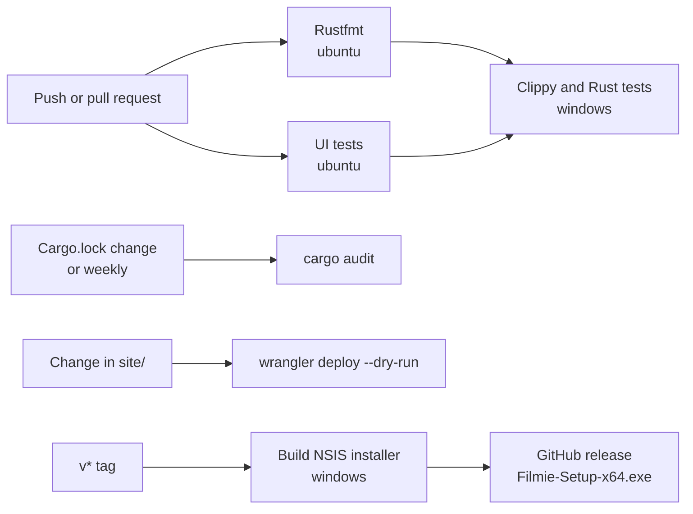

# Filmie

[](https://github.com/abusayed0206/filmie/actions/workflows/ci.yml)
[](https://github.com/abusayed0206/filmie/releases/latest)
[](LICENSE)

Filmie is a lightweight Windows app for browsing movies and TV shows and keeping your [Trakt](https://trakt.tv) history up to date. It can also play video in a built-in player from servers you add yourself.

**[Download for Windows](https://github.com/abusayed0206/filmie/releases/latest/download/Filmie-Setup-x64.exe)** · [Website](https://filmie.sayed.app) · [All releases](https://github.com/abusayed0206/filmie/releases)

> **Filmie doesn't host, store or serve any content.** It includes no video servers. It only shows information from TMDB and Trakt, and opens servers you add yourself. See the [Terms of Use](TERMS.md).

<p align="center">
  
</p>

## Screenshots

These are the real app, signed in to a real Trakt account.

| Title page | Player |
|---|---|
|  |  |
| **Stats** | **Discover** |
|  |  |
| **Ctrl+K palette** | **Filters** |
|  |  |

The player shows a trailer because Filmie ships with no video servers.

## Features

- **Browse:** trending, releases, anticipated, popular and more charts, switching between Media, Shows and Movies, with filters for genre, decade, runtime, rating and more.
- **Find anything:** press **Ctrl+K** to jump to a page or title, or search movies, shows, people and lists.
- **See the details:** seasons and episodes, cast and person pages, comments, videos, related titles and lists.
- **Track with Trakt:** continue watching, calendar, watchlist, history, library, progress, your lists, ratings, favorites, notes and recommendations.
- **See your stats:** totals, top genres, ratings, activity and a watching streak, worked out on your PC with no VIP needed. They work offline too.
- **Stay in control:** nothing is marked as watched until you ask, with no check-ins or scrobbling.
- **Recently played:** your own list and progress, kept on your PC and separate from Trakt. Progress shows when the player exposes its video.
- **Fast and offline-friendly:** TMDB and Trakt responses are cached in a local SQLite database.
- **Move around a show:** switch seasons and jump straight to any episode from the player.
- **Use your own servers:** add as many as you like and switch between them while watching.
- **Download for offline viewing:** save a movie, an episode or a whole season from your servers to a folder you choose, and watch it in the app without a connection. Some videos can't be saved for offline use. Installing [ffmpeg](https://ffmpeg.org) saves streams as single MP4 files.
- **Find more info:** links to IMDb, Letterboxd, TMDB, Rotten Tomatoes, Metacritic and Trakt.
- **Watch distraction-free:** fullscreen mode, and pop-ups from embedded pages are blocked.

## Install

1. Download [`Filmie-Setup-x64.exe`](https://github.com/abusayed0206/filmie/releases/latest/download/Filmie-Setup-x64.exe). Each release also lists its SHA-256 checksum.
2. Run the installer.

Filmie needs 64-bit Windows 10 or 11. The installer adds Microsoft's WebView2 runtime if it's missing.

The installer isn't code-signed yet, so Windows SmartScreen may warn you. To continue, choose **More info**, then **Run anyway**.

## How to use

### Connect Trakt (optional)

1. Open **Settings** and choose **Sign in with Trakt**.
2. Enter the code shown in the app on the Trakt page that opens. The code is copied for you.

You can browse without an account. Signing in adds your library, recommendations and tracking.

### Add a video server

Open **Settings**, go to **Video servers**, and fill in the form.

You need three things:

- **Server link:** the address, starting with `https://`, such as `https://example.com`.
- **Movie structure:** the rest of a movie's link, containing `{tmdb_id}`, such as `/movie/{tmdb_id}`.
- **TV structure:** the rest of an episode's link, containing `{tmdb_id}`, `{season}` and `{episode}`, such as `/tv/{tmdb_id}/{season}/{episode}`.

The form suggests common structures and shows example links before you save. A name, note and accent colour are optional.

To back up your list or add several servers at once, choose **Edit as text**, with one server per line:

```text
My server | https://example.com/movie/{tmdb_id} | https://example.com/tv/{tmdb_id}/{season}/{episode} | Home server | #e5484d
```

### Watch and track

1. Open a title and press **Play**.
2. On a show, use **Episodes** in the player bar to change season or episode.
3. Press **Mark watched** when you finish. You can also add the title to your watchlist or a list from the same bar.

| Shortcut | Action |
|---|---|
| <kbd>F11</kbd> | Toggle fullscreen |
| <kbd>Esc</kbd> | Close a menu, or leave fullscreen |

## Build from source

You need Windows, [Rust](https://rustup.rs) stable and [Node.js](https://nodejs.org) (only for the UI tests).

```powershell
Copy-Item .env.example .env.local   # then fill in your TMDB key and Trakt client ID
./scripts/fetch-ubol.ps1            # downloads the pinned ad blocker
cd src-tauri
cargo run
```

The UI in `ui/` is compiled into the app, so rebuild after changing it. Close any running copy first.

| Task | Command |
|---|---|
| Rust tests | `cargo test` (in `src-tauri`) |
| UI tests | `node --test tests/ui.test.js` |
| Lint and format | `cargo clippy --all-targets -- -D warnings` and `cargo fmt` (in `src-tauri`) |
| Build the installer | `cargo install tauri-cli --version "^2" --locked`, then `cargo tauri build --bundles nsis` (in `src-tauri`) |

Architecture notes are in [CLAUDE.md](CLAUDE.md), and API research and decisions are in [docs/PLAN.md](docs/PLAN.md).

## CI/CD pipeline

All workflows are in [`.github/workflows`](.github/workflows). The shared Rust toolchain, cache, uBlock Origin Lite download and placeholder keys are set up by [`.github/actions/setup`](.github/actions/setup).



| Workflow | Runs on | What it does |
|---|---|---|
| [`ci.yml`](.github/workflows/ci.yml) | Pushes to `main` and pull requests, except docs and `site/` | `cargo fmt --check` and the UI tests on Linux first, then `cargo clippy --all-targets -- -D warnings` and `cargo test` on Windows |
| [`audit.yml`](.github/workflows/audit.yml) | Changes to `Cargo.toml` or `Cargo.lock`, and every Monday | `cargo audit` against the RustSec advisory database |
| [`release.yml`](.github/workflows/release.yml) | `v*` tags, or by hand | Checks the tag matches the app version, builds the installer with the real keys and publishes it with its SHA-256 checksum. A manual run only builds |
| [`site.yml`](.github/workflows/site.yml) | Changes in `site/` | `npm ci` and `wrangler deploy --dry-run`, to check the website's config and assets |

CI compiles with placeholder keys, so forks and pull requests need no secrets. Only `release.yml` uses the `TMDB`, `TRAKT` and `TRAKT_REDIRECT_URI` repository secrets.

### Publish a release

1. Set `version` in `src-tauri/tauri.conf.json`.
2. Push a matching tag, such as `v0.2.0`.

The installer is always named `Filmie-Setup-x64.exe`, so the download links on the website and in this README always point to the latest release.

### Deploy the website

The website in [`site/`](site) is a static-assets Cloudflare Worker served at [filmie.sayed.app](https://filmie.sayed.app). It's deployed by hand:

```bash
cd site
npm ci
npx wrangler dev     # preview at http://localhost:8787
npx wrangler deploy
```

Its screenshots are taken from the running app. See [`scripts/site-shots`](scripts/site-shots/README.md).

## Legal

- [MIT License](LICENSE)
- [Terms of Use](TERMS.md)
- [Privacy](PRIVACY.md)
- [Third-party notices](THIRD_PARTY_NOTICES.md)

Filmie uses TMDB and the TMDB APIs but is not endorsed, certified, or otherwise approved by TMDB. Filmie uses Trakt but is not endorsed or certified by Trakt.
